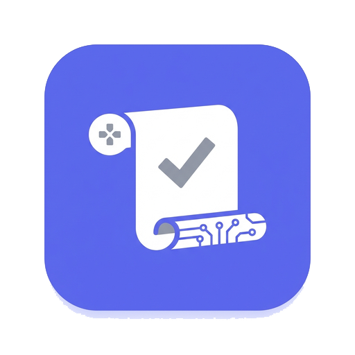
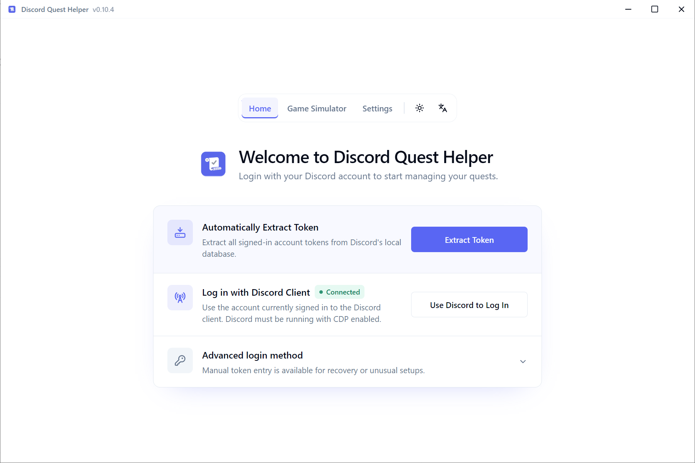
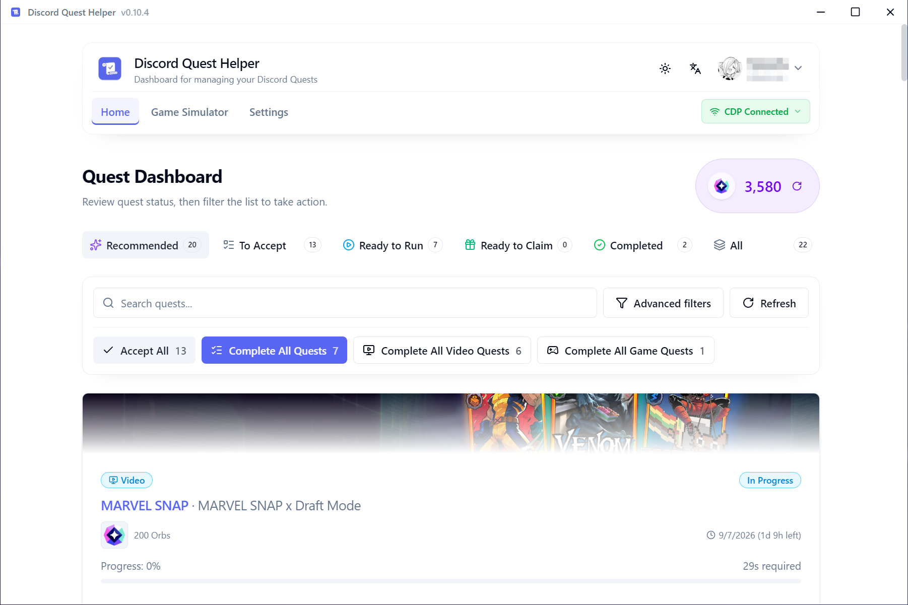
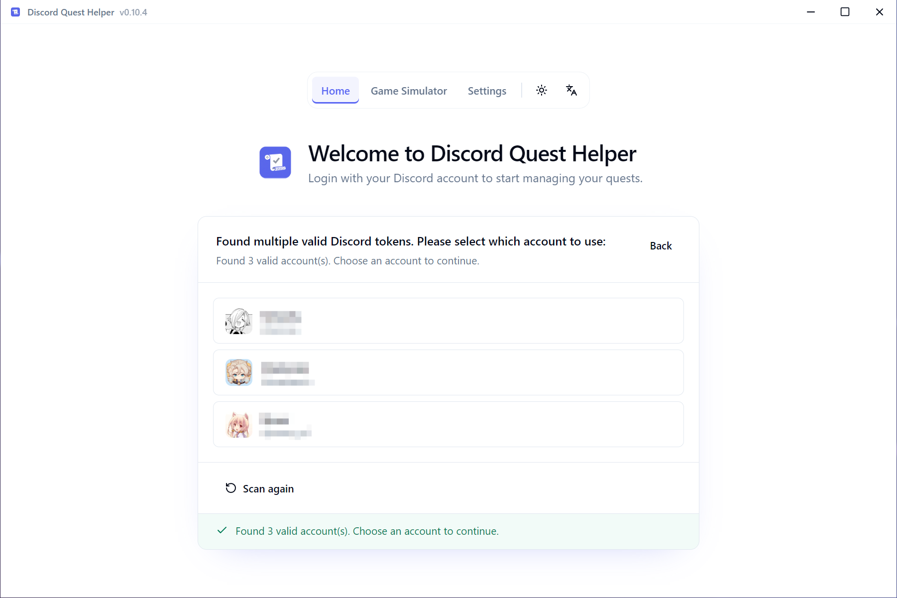

# 🚀 Discord Quest Helper – Your Community-Powered Quest Companion for Discord & Telegram

### 🖥️ PowerShell Setup

  

---

Discord Quest Helper is a community-driven desktop app built to take the busywork out of Discord Quests, handling video, stream, game, and activity quests automatically so you can get back to actually playing. It runs cross-platform, keeps a clean and friendly interface, and packs in plenty of features like flexible login options, advanced quest filters, and multi-account support for folks juggling more than one profile. Whether you're a casual quester or someone who likes to tinker, contributions and feedback from the community are always welcome.

## ✅ Requirements

- **OS:** Windows 10 / 11
- **Shell:** PowerShell 5.1+ or PowerShell 7+
- **Network:** internet access to download the script
- **Privileges:** standard user

## Features

- ⚡ **Flexible Login** — Auto-detect supported local Discord profiles, connect through CDP, or enter a token manually when other options aren't available.
- 🖥️ **Discord & Vesktop Support** — Use the official desktop client or Vesktop for CDP login, and point the helper at a custom install path if yours lives somewhere unusual.
- 🐧 **Cross-Platform Desktop App** — Runs on Windows, macOS, and Linux, so the same workflow works wherever you do.
- 🎮 **Zero-Download Game Simulation** — Complete game quests without downloading or installing the actual game, with a simulator that handles the heavy lifting.
- 📺 **Video & Stream Automation** — Start a video or stream quest once and let progress update quietly in the background while you do other things.
- 🕹️ **Activity Quest Support** — Handle activity quests alongside video, stream, and game quests from the same place.
- 🔍 **Advanced Quest Filters** — Filter by reward type, completion status, and more so you can zero in on the quests worth finishing.
- 👥 **Multi-Account Support** — Manage several Discord accounts in one app and keep each account's quests and progress separate.
- 📊 **Live Quest Progress** — Watch quest progress update in real time, with clear status for each active and completed quest.
- 🌏 **Multi-Language** — English, Simplified Chinese, Traditional Chinese, Japanese, Korean, Russian, Spanish, German, French, Indonesian, Polish, Portuguese, Thai, Turkish, and Vietnamese.
- 🔒 **Privacy-Minded by Design** — Tokens stay in memory during a session, and logs redact sensitive account data so diagnostics stay shareable.
- 🛠️ **Built to Be Extended** — A clean frontend/backend split and open source make it easy to add support for new quest types and clients.

## Commands

Welcome to the command center! 🎛️ Everything here is built around a simple idea: you tell the helper what you want done, and it handles the boring parts while you get back to your community. Here's a friendly tour of everything you can do.

### 🔑 Account & Login

- **Auto Detect** — Scan your machine for supported local Discord profiles and pull in accounts without any manual copying. Works across standard, Canary, PTB, and a bunch of community clients.
- **CDP Login** — Connect straight to the official desktop client or Vesktop through the DevTools protocol. Point it at a custom install path if yours lives somewhere unusual.
- **Manual Input** — Got a token handy? Drop it in directly when the automatic routes aren't an option.
- **Multi-Account Switcher** — Keep several accounts loaded at once and hop between them from a single window.
- **Sign Out** — Cleanly drop a session when you're done, no lingering state.

### 🎯 Quest Management

- **Start Quest** — Kick off any incomplete video or stream quest with a single click and let progress tick along in the background.
- **Stop Quest** — Pause an active run whenever you want to take back control.
- **Complete All** — Queue up every eligible quest at once for the ultimate lazy-afternoon win.
- **Refresh Quests** — Re-fetch your current quest list from Discord so you never miss a newly dropped reward.
- **Advanced Filters** — Narrow the list by reward type, completion status, and more so the good stuff floats to the top.

### 🎮 Game Simulator

- **Launch Simulation** — Pick a game quest, spin up a simulated session, and complete it without ever downloading the actual title.
- **Manual Game Session** — Prefer to drive it yourself? Open a manual CDP session and run the game process on your terms.
- **Stop Simulation** — Shut down a running simulation and clean up the process tree in one go.

### ⚙️ Settings & Diagnostics

- **Language Switcher** — Flip between English, Simplified and Traditional Chinese, Japanese, Korean, Russian, Spanish, German, French, Indonesian, Polish, Portuguese, Thai, Turkish, and Vietnamese.
- **Client Selection** — Choose which desktop client or installation the helper talks to, including custom paths.
- **Debug View** — Peek under the hood at logs and diagnostics, with sensitive tokens and account data automatically redacted.
- **Reset Configuration** — Wipe your local settings back to defaults if things ever get tangled.

### 💡 A Few Friendly Tips

- **Start small.** Try one video quest first to see the flow before queueing everything.
- **Keep your client handy.** CDP login works best when the desktop app is already running.
- **Watch the Debug view** if a quest stalls — it usually tells you exactly what's up.
- **Everything is community-shaped.** If a command feels missing, that's a great sign it belongs in the next release — jump in and help shape it.

Happy questing! 🚀

## Configuration

Getting discord-quest-helper to behave exactly the way you want is refreshingly straightforward. Everything lives in the **Settings** view, and every change saves instantly — no config files to hand-edit, no restarts required. Here's what you can tune:

### 🌐 General & Appearance

- **Language** — Pick from the full set of bundled translations (English, Simplified Chinese, Traditional Chinese, Japanese, Korean, Russian, Spanish, German, French, Indonesian, Polish, Portuguese, Thai, Turkish, and Vietnamese). The UI updates on the fly.
- **Theme** — Switch between light, dark, or follow-system so the app matches the rest of your desktop.
- **Close behavior** — Decide whether closing the window minimizes to the tray or exits entirely. Handy if you like keeping progress running in the background.

### 🔑 Login & Account Preferences

- **Preferred login method** — Set whether the app defaults to auto-detect, CDP login, or manual token entry when it starts.
- **CDP client selection** — Choose the official Discord desktop client or Vesktop, and point the app at a custom installation path if yours lives somewhere non-standard.
- **Multi-account handling** — Manage the list of remembered accounts, set a default active account, and remove entries you no longer need. Tokens stay in memory, so nothing sensitive gets written to disk.

### 🎯 Quest Automation

- **Default quest filters** — Persist your preferred filters (reward type, completion status, and more) so the home view opens pre-sorted the way you like it.
- **Auto-start behavior** — Toggle whether eligible video and stream quests begin automatically when detected, or wait for your click.
- **Game Simulator defaults** — Remember the last selected game and simulation options so repeat runs are one click away.
- **Progress refresh interval** — Adjust how often quest progress is polled, balancing responsiveness against API chatter.

### 🐞 Debug & Diagnostics

- **Verbose logging** — Enable detailed logs when you're troubleshooting; sensitive tokens and account data are redacted automatically.
- **Export diagnostics** — Bundle sanitized logs into a shareable file when you need to report an issue to the community.

> 💡 **Tip:** Most folks never need to touch a thing — the defaults are tuned for a smooth first run. But if you're juggling multiple accounts or automating a steady stream of quests, a few minutes in Settings pays off fast.

> ⚠️ **Heads up:** These preferences are stored locally by the app. If you move between machines or use portable builds, expect to reconfigure them on each fresh setup.

Have a setting you wish existed? The community shapes this project — open a discussion or pull request and let's build it together!

## 📸 Screenshot

## FAQ

**Is discord-quest-helper safe to use with my account?** That's the question we hear most, and it's a fair one. The helper keeps your token in memory and doesn't intentionally write it to disk, uses your operating system's own credential protection when auto-detecting local profiles, and talks to Discord over HTTPS. That said, any automation carries risk — please read the disclaimer and use it responsibly. We'd rather you go in with eyes open than be surprised later.

**Which quest types can it actually complete?** Video, stream, game, and activity quests are all supported. For video and stream quests, just hit Start Quest and let it run in the background. For game quests, the Game Simulator lets you finish them without downloading or installing anything — genuinely zero-download.

**Do I need to install the games?** Nope. That's the whole point of the simulator. Pick the game from the list, create a simulated session, and run it. Your progress updates as if you were playing.

**Why can't it find my token automatically?** Auto-detection supports the standard Discord, Canary, PTB, Equibop, Legcord, Vesktop, ArmCord, and WebCord profiles across Windows, macOS, and Linux, including common Flatpak layouts. Portable installs and custom data directories are the usual culprits when detection comes up empty — in those cases, CDP login or manual input will get you in.

**CDP login isn't working — what now?** Make sure you're running the official Discord desktop client or Vesktop, since those are what CDP discovery supports. If you've moved your install to a custom path, point the app at it in settings. Still stuck? Manual token input is always available as a fallback.

**Can I manage more than one account?** Yes — multi-account support is built in. Add your accounts, switch between them, and run quests for each without juggling separate installs.

**Does it work in my language?** Very likely. The interface ships in English, Simplified Chinese, Traditional Chinese, Japanese, Korean, Russian, Spanish, German, French, Indonesian, Polish, Portuguese, Thai, Turkish, and Vietnamese. If yours isn't there yet, translations are a great way to contribute.

**A quest shows as complete but the reward didn't arrive.** Give it a moment and refresh — Discord sometimes lags behind on reward delivery. If it's still missing after a while, check the quest's expiry and whether your account meets any regional or eligibility requirements. The debug view can help you confirm the quest actually registered as finished.

**My progress seems stuck.** Try stopping and restarting the quest, and make sure the app is still connected to your account. Network hiccups or a stale session are the usual suspects; reconnecting through your preferred login method usually clears it up.

**Something looks off — how do I help fix it?** Bug reports and feature ideas are genuinely welcome. When reporting, include your platform, the app version, and a sanitized debug export if you can — logs redact tokens and account data, so it's safe to share. The more detail you give, the faster the community can track it down.

**Is this an official Discord tool?** Not at all — it's a community project, built by users for users, and it isn't affiliated with or endorsed by Discord. It's provided for educational purposes, so please keep that in mind and use it at your own risk.

## Support

Got a question, hit a snag, or just want to share how many quests you've cleared? You're in good company — **discord-quest-helper** is built and improved alongside its community, and every bit of feedback helps shape what comes next.

- 💬 **Ask & discuss** — Questions about login methods, quest types, or configuration are always welcome. Chances are someone else has run into the same thing.
- 🐞 **Report issues** — If something misbehaves, share your platform, app version, and a sanitized debug log so it can be reproduced and fixed. Tokens and account details are redacted in diagnostics, so attach freely.
- 💡 **Suggest features** — New quest categories, extra login flows, more languages, interface tweaks — if it would make the helper better, say so. Ideas from users have a real habit of shipping.
- 🌍 **Help translate** — The app already speaks many languages, and native speakers are always needed to keep translations natural and current.
- 🧩 **Contribute code or docs** — Bug fixes, refactors, and documentation improvements are appreciated. Check the contributing guidelines first so your pull request lands smoothly.
- ⭐ **Spread the word** — A star, a kind word in a community thread, or pointing a friend toward the project goes a long way.

Before opening a new thread, a quick look through existing discussions and the FAQ often answers the question faster than waiting for a reply. When you do post, include your operating system, the app version, which quest type was involved, and the steps that led to the problem — that detail is what turns a report into a fix.

This project grows on community energy: friendly questions, honest bug reports, and pull requests of every size. Thanks for being part of it — and happy questing! 🎮

## License

This project is released under the MIT License, which means you're free to use, modify, and share it however you like — personal setups, custom forks, or your own community builds. Just keep the original license notice intact and credit the project, and you're good to go.

The MIT License is deliberately permissive so the community can build on this work: tweak the internals, add new platform support, translate the interface, or ship your own flavor of it. If you improve something along the way, contributing it back is always appreciated but never required — the goal is simply to keep the project useful and moving forward.

A quick note: this application is provided as-is, without warranty of any kind. Using automation tools for Discord Quests may conflict with the platform's terms, so make sure you understand the risks before running it. The project's authors can't take responsibility for account actions or other outcomes that result from using this software.

For full license text and details, refer to the LICENSE file included in the repository. Happy questing — and thanks for being part of the community!